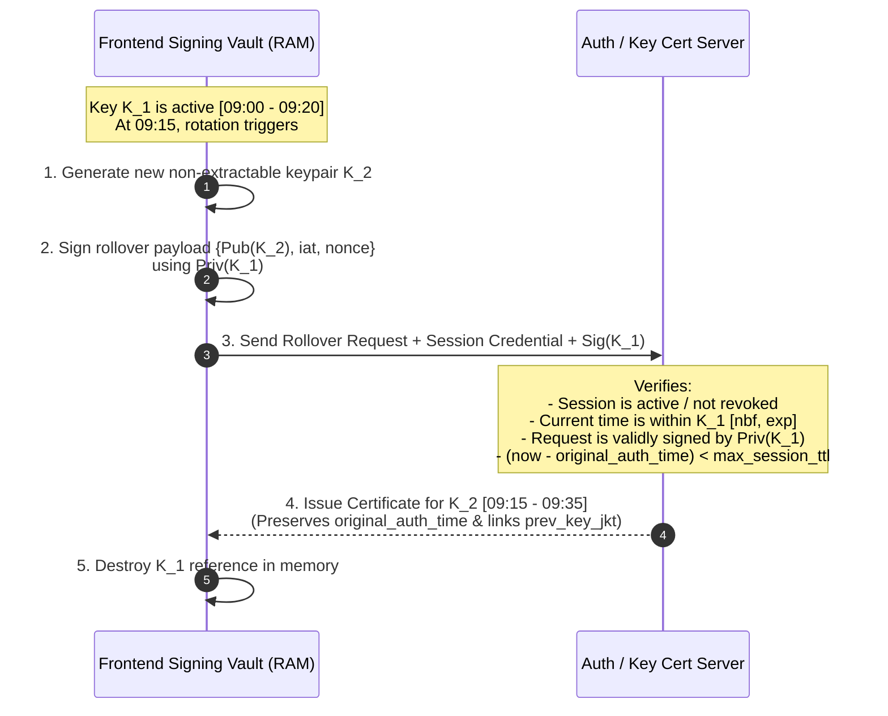
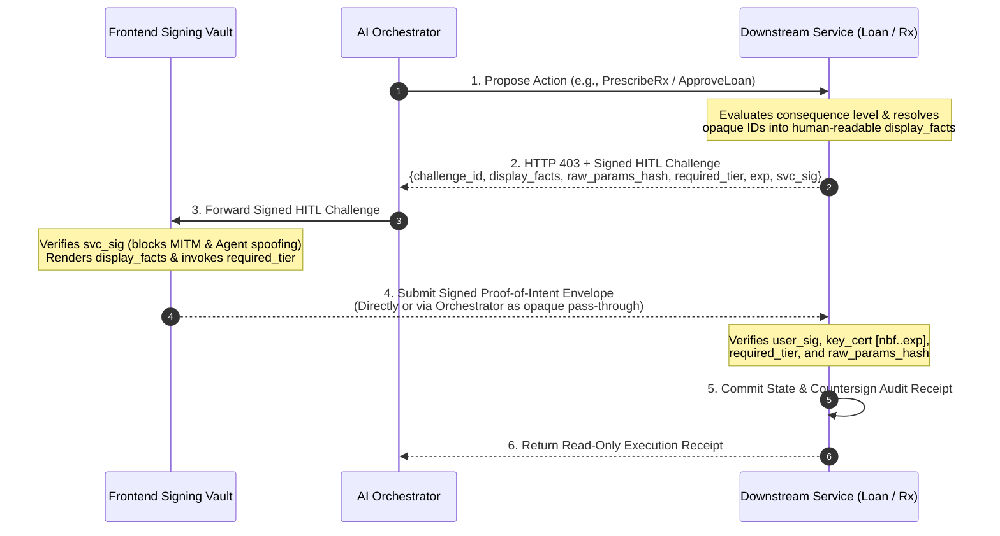
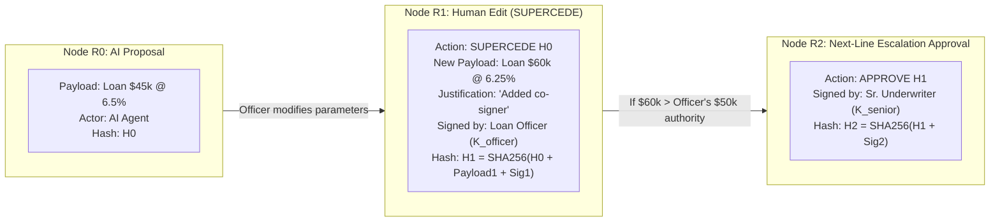

# Proof-of-Intent Architectural Specification

This document defines the end-to-end architecture for cryptographic Proof-of-Intent (PoI) in Human-in-the-Loop (HITL) systems.

---

## 1. System Actors & Trust Boundaries

1. **Identity Provider / Key Certification Authority (IdP):**
   * Authenticates users at login and signs short-lived **Ephemeral Key Certificates** (`[nbf, exp]`) binding the user's identity to a client-generated asymmetric public key.
   * Validates Proof-of-Possession (PoP) key rotation requests during long-lived active sessions.
2. **Frontend Signing Vault (Client):**
   * Generates non-extractable asymmetric keys in browser memory (`window.crypto.subtle.generateKey` with `extractable: false`).
   * Ideally isolated inside a minimal, zero-dependency cross-origin iframe (e.g., `vault.example.com`) with strict CSP (`script-src 'self'`) so that an XSS vulnerability in the host AI chat application cannot invoke the signing API silently or smuggle keys.
   * Renders service-signed `display_facts` and orchestrates Tier 1 (Web Crypto) or Tier 2/3 (WebAuthn) signing.
3. **AI Orchestrator / Agent (Untrusted / Semi-Trusted Intermediary):**
   * Proposes domain actions on behalf of a user or background workflow.
   * **Never trusted** to determine action consequence levels, construct ground-truth human display summaries for opaque IDs, or mutate parameters after human approval.
4. **Downstream Resource Service (Authoritative Policy & Execution Point):**
   * Governs domain risk (e.g., Loan Origination Service, Electronic Prescription Service).
   * Determines required assurance tiers, issues signed HITL challenges, verifies the resulting Proof-of-Intent envelope, evaluates organizational policy (directly or via an external policy engine), commits state, and countersigns an audit receipt.

---

## 2. Ephemeral Key Lifecycle & Anti-Smuggling Controls

### 2.1 Client-Generated & IdP-Certified Keys (Not Server-Issued)
To preserve non-repudiation and ensure a compromised backend cannot forge human signatures:
1. During login, the Frontend Signing Vault generates an asymmetric keypair (`K_1`, e.g., ECDSA P-256 or Ed25519) locally using Web Crypto with `extractable: false`.
2. The `CryptoKey` handle is held strictly in memory (never serialized to `localStorage`; never exported).
3. The client sends `Pub(K_1)` (as a JWK) to the IdP during authentication.
4. The IdP returns a signed **Ephemeral Key Certificate** (an RFC 7800 `cnf` JWT) binding `{ sub, auth_time, nbf, exp, cnf: { jwk: Pub(K_1) } }`.

### 2.2 Proof-of-Possession (PoP) Key Chaining for Rotation
Standard OAuth refresh tokens are bearer secrets -- if smuggled out of the client, an attacker could mint new signing keys on a separate machine. Instead, key rotation uses **PoP Key Chaining**:

**Security Properties of PoP Key Chaining:**
* **Defeats Refresh Token Smuggling:** A stolen refresh cookie/token cannot mint `K_2` without possessing the non-extractable `Priv(K_1)`.
* **Natural Idle Lockout:** If a user leaves their workstation unattended past `K_1`'s `exp` window (e.g., laptop sleeps for 30 minutes), `K_1` expires and can no longer self-sign a rollover to `K_2`. The session automatically drops to read-only until interactive re-authentication.
* **Preserved Freshness Context:** Carrying forward `original_auth_time` allows downstream services to enforce step-up re-authentication if an action requires a recent interactive login regardless of key rotation.

---

## 3. Multi-Tier Assurance Levels

All three assurance tiers produce a signature over the **exact same canonical challenge hash**, allowing uniform verification by downstream services:

| Assurance Tier | User Friction | Browser / Hardware Primitive | Target Use Cases |
| :--- | :--- | :--- | :--- |
| **Tier 1: Session Key** | **Zero extra overhead** (Single UI click inside Vault iframe) | Web Crypto API (`crypto.subtle.sign`) using the IdP-certified ephemeral session key (`extractable: false`). | Routine HITL approvals, low-risk agent tool calls, non-controlled clinical orders, small adjustments. |
| **Tier 2: Platform Biometric** | **Low/Medium** (TouchID, FaceID, Windows Hello) | **W3C WebAuthn** Platform Authenticator (`navigator.credentials.get`) with `challenge = SHA-256(Intent_Payload)` and `userVerification: "required"` (`UV` bit set). | High-value loan approvals, sensitive PII access, production configuration changes. |
| **Tier 3: Hardware Token** | **High** (Physical YubiKey touch + optional FIDO2 PIN) | **W3C WebAuthn** Cross-Platform Roaming Authenticator restricted to registered hardware security key `credentialId`s (`challenge = SHA-256(Intent_Payload)`). | DEA EPCS Schedule II-V controlled substance prescriptions, wire transfers, root security policy changes. |

---

## 4. Two-Phase Signed Challenge Flow (Defeating Confused Deputy & MITM)

To prevent a prompt-injected or hallucinating AI agent from misrepresenting an action to the human (e.g., displaying *"Ibuprofen for Jane Doe"* in chat while passing the `patient_id` for John Smith and the `ndc` code for Oxycodone), the **Downstream Service** generates and signs the HITL challenge:

### Why Ground-Truth `display_facts` Must Be Signed by the Service
Humans cannot validate database UUIDs or raw medical/financial codes. By having the Downstream Service resolve IDs into human-readable facts (e.g., `"Patient: John Smith (DOB: 1975-04-12), Medication: Oxycodone 10mg, Sig: 1 tab PO q6h"`) and sign them (`svc_sig`), the Frontend Signing Vault guarantees **What You See Is What You Sign (WYSIWYS)**.

---

## 5. Synchronous vs. Asynchronous HITL Flows

In real-world operations, an AI agent may prepare a batch of loan packages or prescription refills at **02:00 AM**, while the human underwriter or physician logs in at **09:00 AM** to review their queue.

To prevent **Time-of-Check to Time-of-Use (TOCTOU)** drift without weakening short-lived challenge windows, asynchronous HITL splits **Intent Escrowing** from **Just-in-Time Challenge Minting**:

1. **Stage 1 -- Intent Escrowing (02:00 AM):**
   * The AI Agent submits the proposed action to the Downstream Service.
   * The Service records the proposal (`R0`) in `PENDING_APPROVAL` state and returns an `intent_id`.
2. **Stage 2 -- Just-in-Time Challenge Minting (09:00 AM):**
   * The Approver logs in (obtaining ephemeral key `K_morning` valid `09:00-09:20`) and opens `intent_id` in their queue.
   * The UI requests a fresh challenge for `intent_id` from the Downstream Service.
   * The Service evaluates current domain state at 09:00 AM and mints a **short-lived Signed Challenge** (`nbf: 09:00, exp: 09:05`).
3. **Stage 3 -- Synchronous Cryptographic Signing (09:01 AM):**
   * The Approver reviews and signs the fresh challenge using `K_morning` (or WebAuthn).
   * Both the Service Challenge and the Approver's Ephemeral Key have tight, overlapping validity windows at the exact moment of human intent.

---

## 6. Authoritative Human Edits & Chained Escalations (R0 -> R1 -> R2)

When a human modifies parameters proposed by an AI agent, the human's adjustment (within their organizational authority) is always authoritative.

### 6.1 Never Mutate in Place: `SUPERCEDE`
Rather than mutating the AI's proposal in the database -- which obscures audit attribution between what the AI proposed and what the human authored -- a modification is modeled as a **`SUPERCEDE`** transition:
1. **An immediate rejection/superceding of the previous state (`R0`)**, coupled with
2. **A cryptographically signed assertion of the new state (`R1`)** that embeds `H0 = SHA-256(R0)`.

### 6.2 Three Outcomes of a Human `SUPERCEDE` (R1)
When Human 1 signs and submits `R1` to the Downstream Service, the service evaluates `R1`:

1. **Within Human 1's Role Authority & Current Assurance Tier:**
   * *Example:* Loan Officer reduces a `$45k` loan to `$35k` (limit is `$50k`, Tier 1).
   * *Outcome:* Immediate execution of `R1`. The AI agent is notified via a read-only receipt; the LLM is **never** placed back in the execution path.
2. **Within Human 1's Role Authority, but Higher Cryptographic Assurance Tier Required:**
   * *Example:* Attending Physician changes an AI-proposed order from *Ibuprofen 800mg* (Tier 1) to *Oxycodone 5mg* (Tier 3 Hardware Token).
   * *Outcome:* The physician has legal/organizational authority, so no human escalation is needed, but the Downstream Service immediately responds with a **Tier 3 Step-Up Challenge** for `R1` so the physician can tap their hardware key to complete the order.
3. **Exceeds Human 1's Role Authority (Chained Organizational Escalation):**
   * *Example:* Loan Officer adjusts a loan from `$45k` to `$60k` (exceeding their `$50k` limit) and includes justification metadata.
   * *Outcome:* `R0` is marked `SUPERCEDED`, and `R1` is routed to the **Next-Line Approver's** queue. When the Senior Underwriter opens the item, they see the cryptographically verified lineage: the original request (`R0`), the Loan Officer's exact adjustment and justification (`R1`), and the Officer's valid signature (`Sig1`), before signing the final approval (`R2`).

### 6.3 Concurrent Approver Race Conditions (Compare-and-Swap on `head_node_hash`)
When two approvers (Approver 1 and Approver 2) concurrently view a pending request at `R0` (`H0`), and Approver 1 submits `APPROVE H0` while Approver 2 submits `SUPERCEDE H0`:
* **Linear Chain CAS Invariant:** The Downstream Service only appends a node at `seq: i` if its parent hash pointer equals the current `head_node_hash` (`seq: i - 1`) and the intent is not yet finalized. Silent rebasing is prohibited because the parent hash is inside the user's cryptographic signature.
* **If `SUPERCEDE H0` arrives first:** `head_node_hash` advances to `H1_B`. Approver 1's `APPROVE H0` is rejected with HTTP `409 Conflict` (`stale_head_conflict`, or `intent_already_finalized` if `R1_B` executed immediately), returning `[R0, R1_B]` so Approver 1 can inspect Approver 2's changes and sign `R2` (`APPROVE H1_B`) if needed.
* **If `APPROVE H0` arrives first:** `head_node_hash` advances to `H1_A`.
  * Under a **single-approver** policy, `R0` executes immediately and Approver 2 receives `409 Conflict` (`intent_already_finalized`) with the committed receipt (`CIR`).
  * Under a **multi-approver quorum** policy (where `intent_id` remains pending at `H1_A`), Approver 2 receives `409 Conflict` (`stale_head_conflict`) with `[R0, R1_A]`, allowing Approver 2 to re-sign their modification against `H1_A` -> producing the linear chain `R0 -> R1_A (APPROVE) -> R2 (SUPERCEDE H1_A)`, which explicitly supercedes Approver 1's approval.

---

## 7. Orthogonality of Policy Enforcement & Concurrency Control

A core architectural principle of this framework is that **HITL Proof-of-Intent validity is strictly orthogonal to organizational policy enforcement and in-flight record locking.**

* **Why Orthogonality Matters:**
  1. Organizations have different business policies for different domain conditions.
  2. Organizations use diverse technologies to enforce policies (OPA, AWS Cedar, custom domain code, EHR rule engines, database triggers).
  3. How an organization handles concurrent in-flight modifications to underlying records (optimistic concurrency, pessimistic locking, branch/merge) is an implementation-time domain concern, not a cryptographic proof-of-intent concern.

* **Clean Division of Responsibility:**
  * **The PoI Layer** outputs a deterministic, stateless verification result: *"Here is a mathematically verified chain of assertions `R0 -> ... -> Rn`, with verified signers, timestamps, and assurance tiers."*
  * **The Consuming Service / Policy Layer** takes that verified chain as input and applies its own domain rules to decide whether to commit the transaction, demand further escalation, or reject due to a stale record lock.
